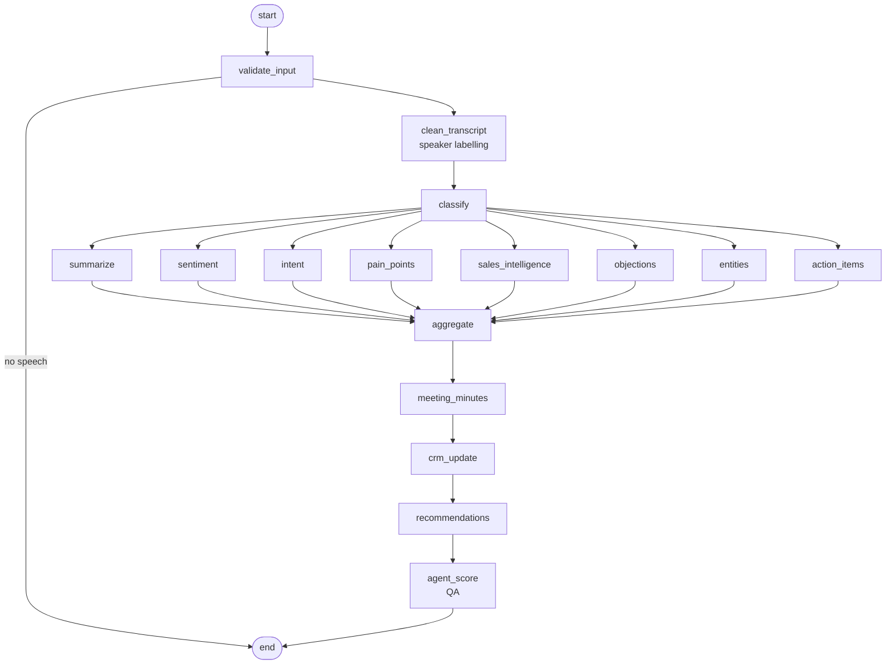

# AI architecture

## Pipeline graph

The conversation pipeline is a compiled LangGraph `StateGraph` (`backend/app/ai/pipeline/graph.py`). Each node is one agent; nodes read the shared state and return only the fields they produce.

`pipeline_mermaid()` in `graph.py` prints the exact compiled graph, including the conditional edges that route to the end when a sequential step fails.

| Stage | Behavior |
|---|---|
| `validate_input` | Stops the run with "No speech was found in the recording" when speech-to-text returned nothing. |
| `clean_transcript` | Labels speakers. Hosted Whisper can't tell voices apart, so with a real LLM the agent also labels each line with a role (Sales Representative, Customer, ...) from what is said. |
| `classify` | Conversation type and purpose; later agents use it (the sales agent only runs for sales-type conversations). |
| Eight analysis agents | Run in the same LangGraph superstep, so they execute concurrently (capped by `LLM_MAX_CONCURRENCY`). A failing agent records an error and the others carry on. |
| `aggregate` | Fan-in: runs once all eight have finished. |
| `meeting_minutes` to `agent_score` | Sequential; each can use earlier results. A failure ends the run as `failed`. |

Progress is reported as steps start and as each parallel agent finishes, and shown in the web app while it polls.

Storing results, embedding and indexing happen in the background job after the graph returns, never inside nodes.

## State

`ConversationState` (`state.py`) is a `TypedDict` with fields for the input transcript and every agent's output. Fields written by several parallel nodes in one superstep have LangGraph reducers:

| Field | Reducer | Why |
|---|---|---|
| `steps_completed` | list append | every node adds its own name |
| `errors` | list append | agent failures accumulate instead of crashing the run |
| `current_step` | keep latest | progress label |

## Structured output and validation

Every agent asks for JSON (`complete_json`, JSON mode) and passes its `task` name. The response then goes through `validate_output(task, raw)` (`ai/schemas/agent_outputs.py`), which parses it into a Pydantic schema for that agent:

- **Repairs** what it safely can: `"85/100"` to `85`, `"01:23"` to `83` seconds, `"High"` to `high`, 70 to 0.7 for probabilities, a single object where a list belongs.
- **Nulls** unknowns: "not mentioned", "n/a" and "Not found in the available conversation" become `null` rather than a guessed value.
- **Clamps** scores to their ranges and falls back to defaults for unusable enum values.
- **Labels** QA scores: the agent score always carries the "AI-generated assessment" disclaimer.
- **Reports** every repair as an issue. The evaluation turns this into a "structured output validity" metric.

Every prompt also ends with shared output rules: JSON only, timestamps as seconds, `null` for anything the transcript doesn't state, never guess names, dates, prices or commitments.

The database layer adds a last safety net: `db/sanitize.py::clean_row` coerces every value to its column type before insert, so one odd value can't fail a whole conversation.

## Providers

| Interface | Implementations | Selected by |
|---|---|---|
| `LLMProvider` | `OpenAILLMProvider` (any OpenAI-compatible API: OpenAI, Groq, local servers), `MockLLMProvider` | `LLM_PROVIDER` |
| `SpeechToTextProvider` | `WhisperAPIProvider` (hosted; ffmpeg converts to 16 kHz mono and splits large files), `WhisperLocalProvider`, `MockSTTProvider` | `STT_PROVIDER` |
| `EmbeddingProvider` | local ONNX all-MiniLM-L6-v2, OpenAI, mock | `EMBEDDING_PROVIDER` |

The OpenAI provider retries rate limits, transport errors and invalid JSON, and caps parallel calls with a semaphore. The mock LLM returns canned responses chosen by the calling agent's `task` name, so it exercises the whole app without an API key. Mock output is clearly not real analysis: every upload gets the same sample sales call.

## Search and the Copilot

- **Indexing** (`rag/indexer.py`): after processing, overlapping transcript windows (with speaker and timestamp) and a summary chunk are embedded into Chroma. Knowledge-base uploads (PDF, DOCX, TXT, MD) are chunked and embedded too.
- **Collections**: one per embedding model, because vectors from different models aren't comparable. Run `scripts/reindex.py --all` after switching provider.
- **Copilot** (`agents/copilot_agent.py`): retrieves the most relevant chunks, adds structured records (one conversation's summary, sales signals, tasks and objections, or an index of recent conversations), and asks the LLM to answer only from them with numbered citations. Only cited sources are returned. Agents' searches are limited to their own conversations plus the knowledge base.
- **Natural-language analytics** (`POST /ai/natural-language-query`): recognized questions map to predefined, parameterized queries; the LLM never writes SQL. Anything else falls back to the Copilot.

## On-demand agents

| Agent | Purpose | Safeguard |
|---|---|---|
| Copilot | Questions about one conversation or across conversations and documents | Answers only from cited sources; says "Not found in the available conversations." otherwise |
| Follow-up email | Drafts a follow-up from the summary, tasks and sales signals | Draft only; the user edits, copies or opens it in their mail app |
| Executive report | Writes management reports from computed metrics | Gets only the metrics; told not to invent numbers or comparisons. Without a real LLM, lists the metrics instead |

## Evaluation

`backend/evaluation` holds a hand-labelled dataset of six conversations and a runner that scores the pipeline with the configured model (see `backend/evaluation/README.md`). With Groq `openai/gpt-oss-120b`, after the prompt fixes the evaluation led to:

| Metric | Result |
|---|---|
| Conversation type and customer intent accuracy | 100% each (6 conversations) |
| Overall sentiment accuracy | 83% (5 of 6) |
| Purchase intent accuracy | 50% (4 labelled conversations) |
| Objection categories F1 | 84% |
| Competitor mentions F1 | 89% |
| Action items F1 | 80% |
| Key facts present in summaries | 100% |
| Responses valid against their schema without repair | 96% (up from 53% before timestamps were specified as seconds) |

The dataset is small and synthetic, so these figures are indicative, not a benchmark.
