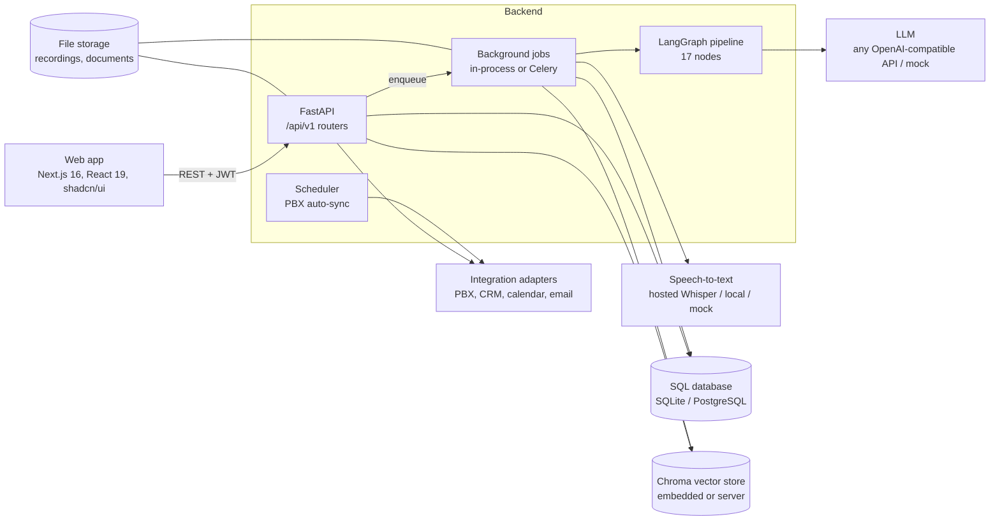
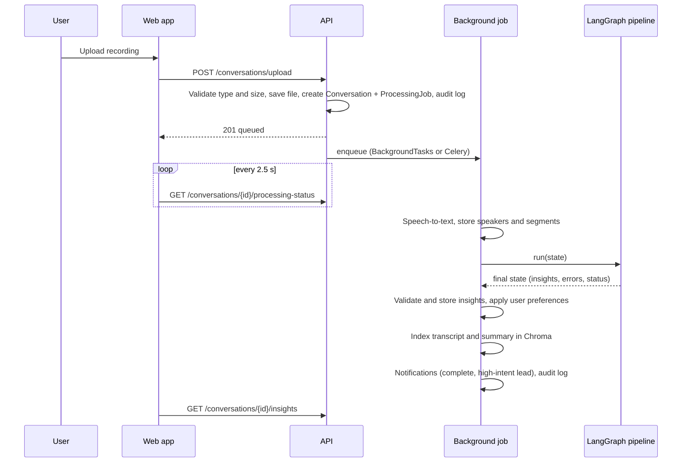

# System architecture

TalkWiseAI turns recorded business conversations (sales calls, support calls, meetings) into structured intelligence. It is two applications: a Next.js web app and a FastAPI backend that runs a LangGraph multi-agent pipeline.

## Components

| Component | Where | Responsibility |
|---|---|---|
| Web app | `frontend/src/app` | Every page is a client component. Talks to the API with axios (`lib/api/client.ts`), keeps the session in a persisted zustand store, refreshes expired access tokens once and signs out on failure. |
| API | `backend/app/api/v1` | 14 routers, 66 endpoints (`docs/API.md`). Authentication, role checks, organization scoping, validation. |
| Background jobs | `backend/app/workers/conversation_tasks.py` | Transcribe, run the pipeline, store results, index for search, notify. Runs as a FastAPI background task by default, or on Celery workers with `TASK_QUEUE=celery`. |
| Pipeline | `backend/app/ai/pipeline` | LangGraph `StateGraph` of 17 nodes; see `docs/AI_ARCHITECTURE.md`. Nodes never touch the database. |
| Providers | `backend/app/ai/providers` | LLM, speech-to-text and embedding interfaces with real and mock implementations, chosen by settings. |
| Search | `backend/app/ai/rag` | Chroma collections per embedding model; transcript windows, summaries and knowledge documents, every query filtered by organization. |
| Integrations | `backend/app/integrations` | Adapter interfaces plus mock implementations and a registry of per-organization settings (`docs/INTEGRATIONS.md`). |
| Scheduler | `backend/app/services/scheduler.py` | Runs inside the API process; imports new PBX calls every 15 minutes for organizations that opted in. |
| Cache | `backend/app/core/cache.py` | Analytics, Copilot answers and job status; in memory or Redis, invalidated by commits. |
| Database | `backend/app/db` | SQLAlchemy models, Alembic migrations, AI-output sanitizer (`docs/DATABASE.md`). |

## Processing an upload

If speech-to-text finds no speech, or a step the rest depend on fails, the job marks the conversation `failed` with a message the user can act on (for example "The AI provider rejected the API key"); full tracebacks stay in the server log. `POST /conversations/{id}/reprocess` clears the results and runs everything again.

## Security and privacy

| Concern | Implementation |
|---|---|
| Passwords | bcrypt hashes (`core/security.py`). Change password needs the current one; reset tokens expire after 30 minutes and stop working once the password changes. Reset requests answer the same way whether or not the email exists. |
| Sessions | JWT access (60 min) and refresh (7 days) tokens. Deactivated users can't sign in or refresh. |
| Roles | admin, manager, agent (`core/access.py`, `require_roles`). Admins manage users, integrations and the knowledge base; managers see team analytics and generate reports; agents see only the conversations they uploaded. |
| Organization isolation | Every query filters by the user's organization; vector searches filter by `organization_id` metadata. |
| Rate limiting | Per-IP sliding window (`core/rate_limit.py`): 10 per minute on login, register and password reset, a general limit elsewhere. In memory, or shared in Redis with `CACHE_BACKEND=redis`. CORS preflights don't count, and 429 responses carry CORS headers. |
| Input and file validation | Pydantic request models; upload extension and size checks; uploaded files get random names. |
| AI output | Validated against per-agent schemas before storage (`ai/schemas/agent_outputs.py`); unknown values stored as null. |
| Human approval | CRM writes only happen after a person approves a proposal; emails are drafted, never sent automatically. |
| Secrets | Environment variables only. `backend/.env.local` is git-ignored; integration settings in the database are non-secret by design. |
| Errors | Production responses hide internal details; development returns the exception text. |
| Audit log | Logins, uploads, deletions, reprocessing, AI processing results, CRM approvals and rejections, user and role changes, integration changes, report generation, knowledge-base changes, password events. Admins see it on the Settings page. |
| Deletion | Deleting a conversation removes the recording, transcript, insights, CRM proposals and its search vectors. |

## Caching

`app/core/cache.py` caches analytics responses (60 s), Copilot answers (10 min) and job progress for the processing-status poll. The backend is `CACHE_BACKEND`: `memory` (per process, default), `redis` (shared by API replicas and Celery workers) or `none`.

Entries are keyed with the organization's current *generation*. A SQLAlchemy hook collects the `organization_id` of every row written in a session and increments those generations after the commit, so any upload, deletion, task change or setting change invalidates the organization's cached results at once, without listing write paths by hand. Agents get their own cache entries because they see different data. Redis failures behave like cache misses.

With `CACHE_BACKEND=redis`, the rate limiter also moves to Redis (a sliding window in a sorted set per client), so limits are shared across replicas.

## Background jobs

| Mode | When to use | How it runs |
|---|---|---|
| `TASK_QUEUE=background` (default) | Local development, single-server deployments | FastAPI `BackgroundTasks` call `run_conversation_pipeline_direct` in a worker thread after the response is sent. No Redis needed. |
| `TASK_QUEUE=celery` | Several API replicas or heavy load | The API enqueues `process_conversation` on Redis; `celery -A app.workers.celery_app worker` runs it. Use a Chroma server (`CHROMA_HOST`) so all processes share the index. |

Both paths call the same function, so behavior and error handling are identical.

## Deployment shape

Local development uses SQLite, embedded Chroma and in-process jobs. Docker Compose runs PostgreSQL, the API and the web app, with an override adding Redis, Celery workers and a Chroma server. See `docs/DEPLOYMENT.md`.
