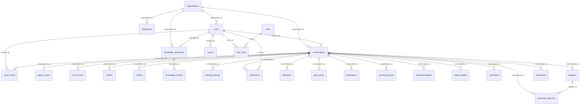

# Database schema

Generated from the SQLAlchemy models (`backend/app/db/models/models.py`) by
`backend/scripts/generate_docs.py`; don't edit by hand.

- Primary keys are UUID strings (`VARCHAR(36)`).
- Every organization-owned row carries `organization_id`, directly or through its conversation.
- The schema is managed by Alembic (`backend/alembic/versions`). Run `python -m app.db.migrate`
  (also run by `start.py`, the seed script and the Docker entrypoint) to create or upgrade it.
- SQLite is used for local development and tests; PostgreSQL in Docker and production.

## Entity overview

## `audit_logs`

| Column | Type | Null | Notes |
|---|---|---|---|
| `id` | VARCHAR(36) | no | primary key |
| `organization_id` | VARCHAR(36) | no |  |
| `user_id` | VARCHAR(36) | yes |  |
| `action` | VARCHAR(100) | no |  |
| `resource_type` | VARCHAR(50) | yes |  |
| `resource_id` | VARCHAR(255) | yes |  |
| `details` | JSON | yes |  |
| `ip_address` | VARCHAR(50) | yes |  |
| `user_agent` | VARCHAR(500) | yes |  |
| `created_at` | DATETIME | no |  |

Indexes: `ix_audit_action`, `ix_audit_org`, `ix_audit_user`

## `organizations`

| Column | Type | Null | Notes |
|---|---|---|---|
| `id` | VARCHAR(36) | no | primary key |
| `name` | VARCHAR(255) | no |  |
| `slug` | VARCHAR(100) | no | unique |
| `plan` | VARCHAR(50) | no |  |
| `is_active` | BOOLEAN | no |  |
| `settings` | JSON | yes |  |
| `created_at` | DATETIME | no |  |
| `updated_at` | DATETIME | no |  |

## `roles`

| Column | Type | Null | Notes |
|---|---|---|---|
| `id` | VARCHAR(36) | no | primary key |
| `name` | VARCHAR(50) | no | unique |
| `description` | TEXT | yes |  |
| `permissions` | JSON | yes |  |

## `integrations`

| Column | Type | Null | Notes |
|---|---|---|---|
| `id` | VARCHAR(36) | no | primary key |
| `organization_id` | VARCHAR(36) | no | references `organizations.id` |
| `integration_type` | VARCHAR(50) | no |  |
| `provider` | VARCHAR(50) | no |  |
| `is_enabled` | BOOLEAN | no |  |
| `is_connected` | BOOLEAN | no |  |
| `config` | JSON | no |  |
| `last_synced_at` | DATETIME | yes |  |
| `created_at` | DATETIME | no |  |

## `users`

| Column | Type | Null | Notes |
|---|---|---|---|
| `id` | VARCHAR(36) | no | primary key |
| `organization_id` | VARCHAR(36) | no | references `organizations.id` |
| `email` | VARCHAR(255) | no | unique |
| `hashed_password` | VARCHAR(255) | no |  |
| `full_name` | VARCHAR(255) | no |  |
| `is_active` | BOOLEAN | no |  |
| `is_verified` | BOOLEAN | no |  |
| `avatar_url` | VARCHAR(512) | yes |  |
| `preferences` | JSON | no |  |
| `last_login_at` | DATETIME | yes |  |
| `created_at` | DATETIME | no |  |
| `updated_at` | DATETIME | no |  |

Indexes: `ix_users_email`, `ix_users_org`

## `conversations`

| Column | Type | Null | Notes |
|---|---|---|---|
| `id` | VARCHAR(36) | no | primary key |
| `organization_id` | VARCHAR(36) | no | references `organizations.id` |
| `created_by` | VARCHAR(36) | no | references `users.id` |
| `title` | VARCHAR(500) | no |  |
| `conversation_type` | VARCHAR(50) | no |  |
| `status` | VARCHAR(50) | no |  |
| `duration_seconds` | INTEGER | yes |  |
| `language` | VARCHAR(10) | no |  |
| `file_path` | VARCHAR(1024) | yes |  |
| `file_name` | VARCHAR(512) | yes |  |
| `file_size_bytes` | INTEGER | yes |  |
| `file_type` | VARCHAR(50) | yes |  |
| `error_message` | TEXT | yes |  |
| `extra_metadata` | JSON | no |  |
| `occurred_at` | DATETIME | yes |  |
| `created_at` | DATETIME | no |  |
| `updated_at` | DATETIME | no |  |

Indexes: `ix_conversations_created`, `ix_conversations_org`, `ix_conversations_status`, `ix_conversations_type`

## `knowledge_documents`

| Column | Type | Null | Notes |
|---|---|---|---|
| `id` | VARCHAR(36) | no | primary key |
| `organization_id` | VARCHAR(36) | no | references `organizations.id` |
| `uploaded_by` | VARCHAR(36) | no | references `users.id` |
| `title` | VARCHAR(500) | no |  |
| `file_name` | VARCHAR(512) | no |  |
| `file_path` | VARCHAR(1024) | no |  |
| `file_type` | VARCHAR(50) | no |  |
| `file_size_bytes` | INTEGER | yes |  |
| `category` | VARCHAR(100) | no |  |
| `status` | VARCHAR(50) | no |  |
| `chunk_count` | INTEGER | no |  |
| `created_at` | DATETIME | no |  |

Indexes: `ix_knowledge_docs_org`

## `reports`

| Column | Type | Null | Notes |
|---|---|---|---|
| `id` | VARCHAR(36) | no | primary key |
| `organization_id` | VARCHAR(36) | no |  |
| `created_by` | VARCHAR(36) | no | references `users.id` |
| `report_type` | VARCHAR(50) | no |  |
| `title` | VARCHAR(500) | no |  |
| `date_from` | DATETIME | yes |  |
| `date_to` | DATETIME | yes |  |
| `data` | JSON | no |  |
| `file_path` | VARCHAR(1024) | yes |  |
| `status` | VARCHAR(20) | no |  |
| `created_at` | DATETIME | no |  |

## `user_roles`

| Column | Type | Null | Notes |
|---|---|---|---|
| `id` | VARCHAR(36) | no | primary key |
| `user_id` | VARCHAR(36) | no | references `users.id` |
| `role_id` | VARCHAR(36) | no | references `roles.id` |
| `assigned_at` | DATETIME | no |  |

Indexes: `ix_user_roles_user`

## `action_items`

| Column | Type | Null | Notes |
|---|---|---|---|
| `id` | VARCHAR(36) | no | primary key |
| `conversation_id` | VARCHAR(36) | yes | references `conversations.id` |
| `organization_id` | VARCHAR(36) | no |  |
| `created_by` | VARCHAR(36) | yes | references `users.id` |
| `description` | TEXT | no |  |
| `owner` | VARCHAR(255) | yes |  |
| `owner_speaker_label` | VARCHAR(50) | yes |  |
| `due_date` | VARCHAR(100) | yes |  |
| `due_date_parsed` | DATETIME | yes |  |
| `priority` | VARCHAR(20) | no |  |
| `status` | VARCHAR(20) | no |  |
| `completed_at` | DATETIME | yes |  |
| `source_timestamp` | FLOAT | yes |  |
| `related_topic` | VARCHAR(255) | yes |  |
| `created_at` | DATETIME | no |  |
| `updated_at` | DATETIME | no |  |

Indexes: `ix_action_items_org`

## `agent_scores`

| Column | Type | Null | Notes |
|---|---|---|---|
| `id` | VARCHAR(36) | no | primary key |
| `conversation_id` | VARCHAR(36) | no | references `conversations.id`, unique |
| `overall_score` | INTEGER | yes |  |
| `greeting_score` | INTEGER | yes |  |
| `professionalism_score` | INTEGER | yes |  |
| `empathy_score` | INTEGER | yes |  |
| `listening_score` | INTEGER | yes |  |
| `question_quality_score` | INTEGER | yes |  |
| `product_knowledge_score` | INTEGER | yes |  |
| `objection_handling_score` | INTEGER | yes |  |
| `closing_score` | INTEGER | yes |  |
| `talk_ratio` | FLOAT | yes |  |
| `interruption_count` | INTEGER | yes |  |
| `filler_word_count` | INTEGER | yes |  |
| `strengths` | JSON | yes |  |
| `weaknesses` | JSON | yes |  |
| `improvement_suggestions` | JSON | yes |  |
| `coaching_notes` | TEXT | yes |  |
| `disclaimer` | TEXT | no |  |
| `created_at` | DATETIME | no |  |

## `crm_records`

| Column | Type | Null | Notes |
|---|---|---|---|
| `id` | VARCHAR(36) | no | primary key |
| `conversation_id` | VARCHAR(36) | no | references `conversations.id` |
| `organization_id` | VARCHAR(36) | no |  |
| `crm_entity_type` | VARCHAR(50) | no |  |
| `crm_entity_id` | VARCHAR(255) | yes |  |
| `proposed_changes` | JSON | no |  |
| `status` | VARCHAR(20) | no |  |
| `approved_by` | VARCHAR(36) | yes |  |
| `applied_at` | DATETIME | yes |  |
| `created_at` | DATETIME | no |  |

## `entities`

| Column | Type | Null | Notes |
|---|---|---|---|
| `id` | VARCHAR(36) | no | primary key |
| `conversation_id` | VARCHAR(36) | no | references `conversations.id` |
| `entity_type` | VARCHAR(50) | no |  |
| `value` | VARCHAR(500) | no |  |
| `context` | TEXT | yes |  |
| `timestamp` | FLOAT | yes |  |
| `sentiment` | VARCHAR(20) | yes |  |
| `mention_count` | INTEGER | no |  |

## `intents`

| Column | Type | Null | Notes |
|---|---|---|---|
| `id` | VARCHAR(36) | no | primary key |
| `conversation_id` | VARCHAR(36) | no | references `conversations.id`, unique |
| `primary_intent` | VARCHAR(100) | no |  |
| `secondary_intents` | JSON | no |  |
| `confidence` | FLOAT | yes |  |
| `evidence` | JSON | no |  |
| `created_at` | DATETIME | no |  |

## `knowledge_chunks`

| Column | Type | Null | Notes |
|---|---|---|---|
| `id` | VARCHAR(36) | no | primary key |
| `document_id` | VARCHAR(36) | no | references `knowledge_documents.id` |
| `organization_id` | VARCHAR(36) | no |  |
| `chunk_index` | INTEGER | no |  |
| `text` | TEXT | no |  |
| `vector_id` | VARCHAR(255) | yes |  |
| `extra_metadata` | JSON | yes |  |

## `meeting_minutes`

| Column | Type | Null | Notes |
|---|---|---|---|
| `id` | VARCHAR(36) | no | primary key |
| `conversation_id` | VARCHAR(36) | no | references `conversations.id`, unique |
| `objective` | TEXT | yes |  |
| `participants_summary` | TEXT | yes |  |
| `discussion_points` | JSON | no |  |
| `decisions` | JSON | no |  |
| `action_items_summary` | JSON | no |  |
| `open_questions` | JSON | no |  |
| `risks` | JSON | no |  |
| `next_steps` | JSON | no |  |
| `next_meeting` | VARCHAR(255) | yes |  |
| `formatted_markdown` | TEXT | yes |  |
| `created_at` | DATETIME | no |  |

## `notifications`

| Column | Type | Null | Notes |
|---|---|---|---|
| `id` | VARCHAR(36) | no | primary key |
| `user_id` | VARCHAR(36) | no | references `users.id` |
| `conversation_id` | VARCHAR(36) | yes | references `conversations.id` |
| `type` | VARCHAR(50) | no |  |
| `title` | VARCHAR(255) | no |  |
| `message` | TEXT | no |  |
| `is_read` | BOOLEAN | no |  |
| `created_at` | DATETIME | no |  |

Indexes: `ix_notifications_user`

## `objections`

| Column | Type | Null | Notes |
|---|---|---|---|
| `id` | VARCHAR(36) | no | primary key |
| `conversation_id` | VARCHAR(36) | no | references `conversations.id` |
| `category` | VARCHAR(100) | no |  |
| `description` | TEXT | no |  |
| `exact_quote` | TEXT | yes |  |
| `timestamp` | FLOAT | yes |  |
| `severity` | VARCHAR(20) | no |  |
| `was_resolved` | BOOLEAN | no |  |
| `suggested_response` | TEXT | yes |  |

## `pain_points`

| Column | Type | Null | Notes |
|---|---|---|---|
| `id` | VARCHAR(36) | no | primary key |
| `conversation_id` | VARCHAR(36) | no | references `conversations.id` |
| `category` | VARCHAR(100) | no |  |
| `description` | TEXT | no |  |
| `severity` | VARCHAR(20) | no |  |
| `desired_outcome` | TEXT | yes |  |
| `potential_solution` | TEXT | yes |  |
| `evidence` | TEXT | yes |  |
| `timestamp` | FLOAT | yes |  |

## `participants`

| Column | Type | Null | Notes |
|---|---|---|---|
| `id` | VARCHAR(36) | no | primary key |
| `conversation_id` | VARCHAR(36) | no | references `conversations.id` |
| `name` | VARCHAR(255) | no |  |
| `email` | VARCHAR(255) | yes |  |
| `role` | VARCHAR(100) | yes |  |
| `is_agent` | BOOLEAN | no |  |
| `crm_contact_id` | VARCHAR(255) | yes |  |

## `processing_jobs`

| Column | Type | Null | Notes |
|---|---|---|---|
| `id` | VARCHAR(36) | no | primary key |
| `conversation_id` | VARCHAR(36) | no | references `conversations.id` |
| `celery_task_id` | VARCHAR(255) | yes |  |
| `job_type` | VARCHAR(50) | no |  |
| `status` | VARCHAR(50) | no |  |
| `progress` | INTEGER | no |  |
| `current_step` | VARCHAR(100) | yes |  |
| `error_message` | TEXT | yes |  |
| `started_at` | DATETIME | yes |  |
| `completed_at` | DATETIME | yes |  |
| `created_at` | DATETIME | no |  |

## `recommendations`

| Column | Type | Null | Notes |
|---|---|---|---|
| `id` | VARCHAR(36) | no | primary key |
| `conversation_id` | VARCHAR(36) | no | references `conversations.id` |
| `category` | VARCHAR(100) | no |  |
| `action` | TEXT | no |  |
| `reasoning` | TEXT | yes |  |
| `priority` | VARCHAR(20) | no |  |
| `urgency` | VARCHAR(20) | no |  |
| `evidence` | JSON | no |  |
| `created_at` | DATETIME | no |  |

## `sales_insights`

| Column | Type | Null | Notes |
|---|---|---|---|
| `id` | VARCHAR(36) | no | primary key |
| `conversation_id` | VARCHAR(36) | no | references `conversations.id`, unique |
| `lead_score` | INTEGER | yes |  |
| `purchase_intent` | VARCHAR(20) | yes |  |
| `deal_health` | VARCHAR(20) | yes |  |
| `budget_discussed` | BOOLEAN | no |  |
| `budget_range` | VARCHAR(255) | yes |  |
| `decision_maker_present` | BOOLEAN | no |  |
| `timeline_discussed` | BOOLEAN | no |  |
| `timeline` | VARCHAR(255) | yes |  |
| `buying_signals` | JSON | no |  |
| `upsell_opportunities` | JSON | no |  |
| `cross_sell_opportunities` | JSON | no |  |
| `stage` | VARCHAR(50) | yes |  |
| `closing_probability` | FLOAT | yes |  |
| `created_at` | DATETIME | no |  |

## `sentiments`

| Column | Type | Null | Notes |
|---|---|---|---|
| `id` | VARCHAR(36) | no | primary key |
| `conversation_id` | VARCHAR(36) | no | references `conversations.id`, unique |
| `overall_sentiment` | VARCHAR(20) | no |  |
| `overall_score` | FLOAT | yes |  |
| `customer_sentiment` | VARCHAR(20) | yes |  |
| `agent_sentiment` | VARCHAR(20) | yes |  |
| `sentiment_trend` | VARCHAR(100) | yes |  |
| `timeline` | JSON | no |  |
| `positive_moments` | JSON | no |  |
| `negative_moments` | JSON | no |  |
| `frustration_detected` | BOOLEAN | no |  |
| `satisfaction_detected` | BOOLEAN | no |  |
| `created_at` | DATETIME | no |  |

## `speakers`

| Column | Type | Null | Notes |
|---|---|---|---|
| `id` | VARCHAR(36) | no | primary key |
| `conversation_id` | VARCHAR(36) | no | references `conversations.id` |
| `speaker_label` | VARCHAR(50) | no |  |
| `display_name` | VARCHAR(255) | yes |  |
| `role` | VARCHAR(100) | yes |  |
| `talk_time_seconds` | FLOAT | yes |  |
| `word_count` | INTEGER | yes |  |
| `crm_user_id` | VARCHAR(255) | yes |  |

## `summaries`

| Column | Type | Null | Notes |
|---|---|---|---|
| `id` | VARCHAR(36) | no | primary key |
| `conversation_id` | VARCHAR(36) | no | references `conversations.id`, unique |
| `executive_summary` | TEXT | no |  |
| `detailed_summary` | TEXT | no |  |
| `key_topics` | JSON | no |  |
| `decisions` | JSON | no |  |
| `important_moments` | JSON | no |  |
| `open_questions` | JSON | no |  |
| `next_steps` | JSON | no |  |
| `created_at` | DATETIME | no |  |

## `transcript_segments`

| Column | Type | Null | Notes |
|---|---|---|---|
| `id` | VARCHAR(36) | no | primary key |
| `conversation_id` | VARCHAR(36) | no | references `conversations.id` |
| `speaker_id` | VARCHAR(36) | yes | references `speakers.id` |
| `speaker_label` | VARCHAR(50) | yes |  |
| `start_time` | FLOAT | no |  |
| `end_time` | FLOAT | no |  |
| `text` | TEXT | no |  |
| `confidence` | FLOAT | yes |  |
| `sequence_index` | INTEGER | no |  |
| `is_important` | BOOLEAN | no |  |
| `importance_reason` | VARCHAR(255) | yes |  |

Indexes: `ix_segments_conversation`, `ix_segments_start_time`
